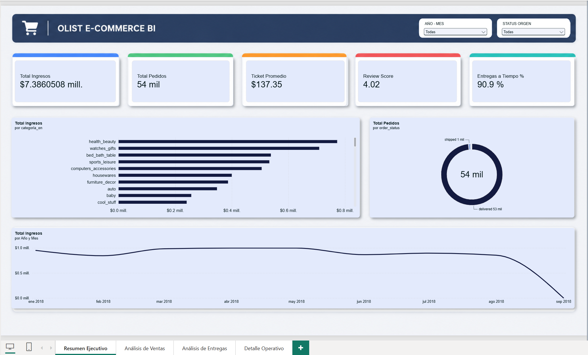
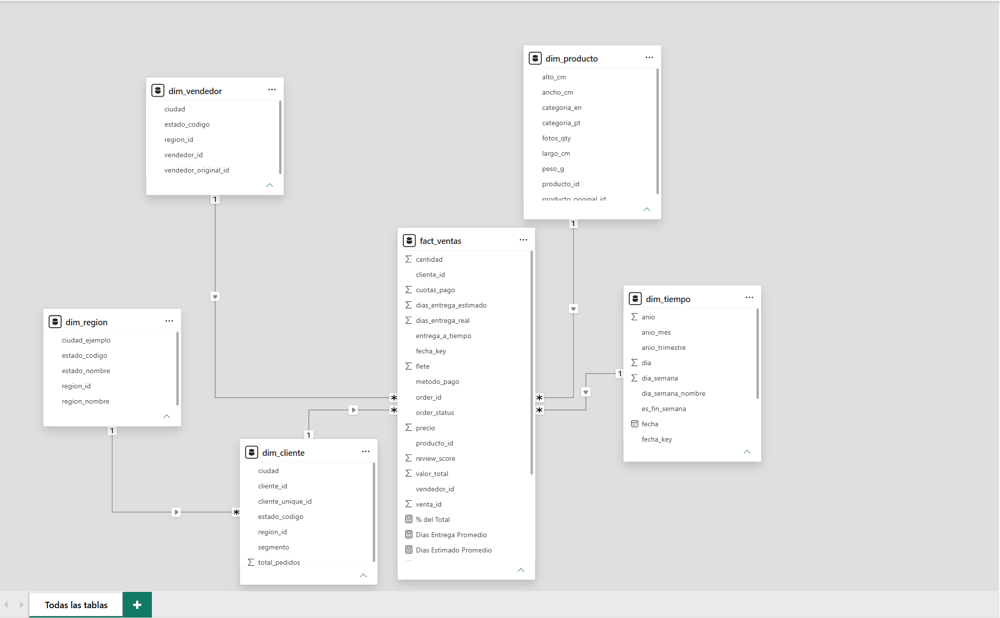
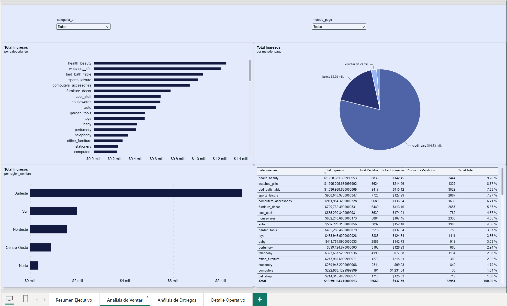
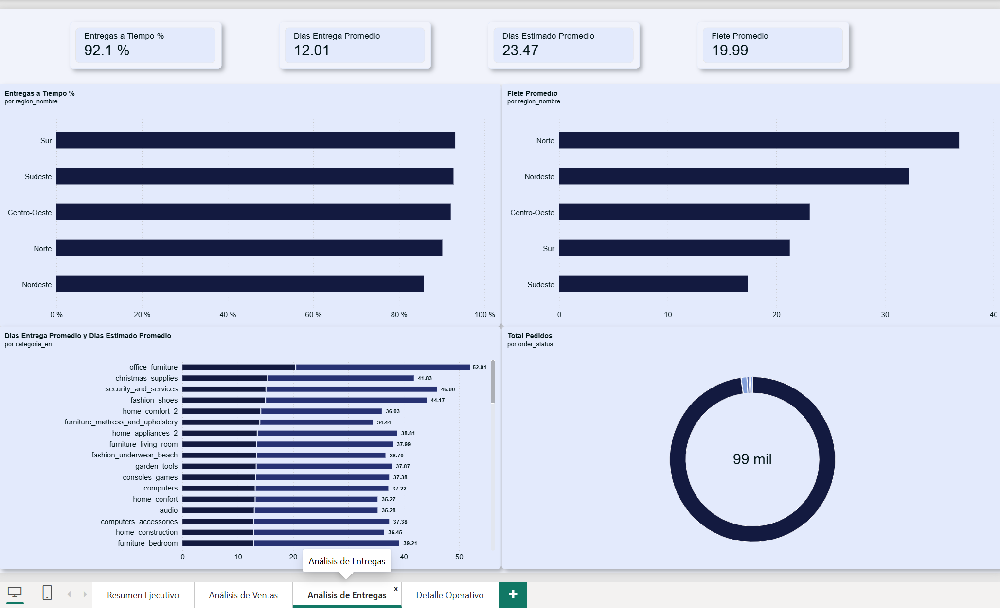
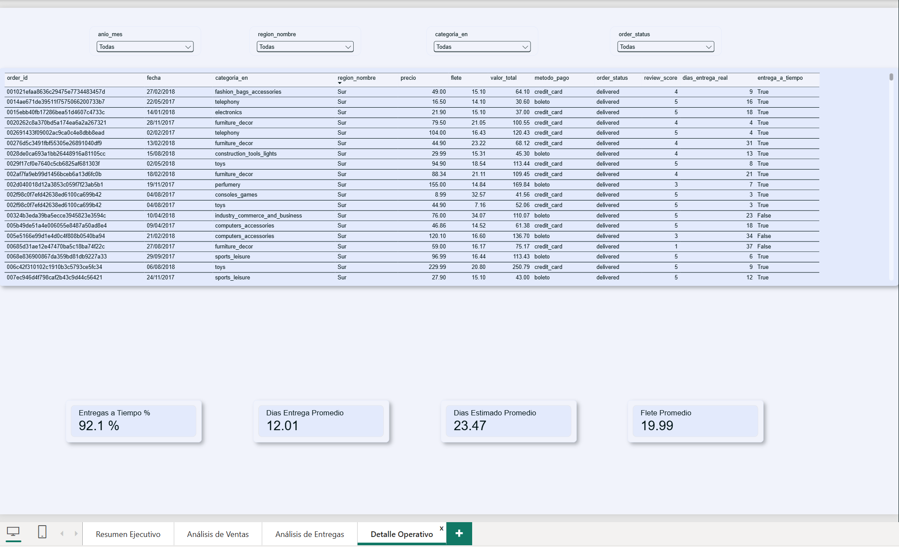
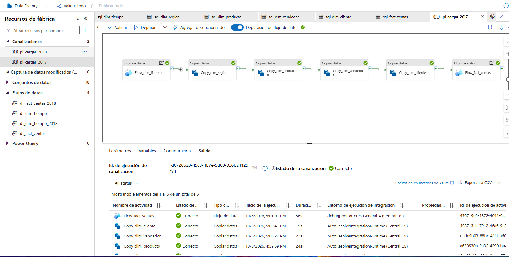
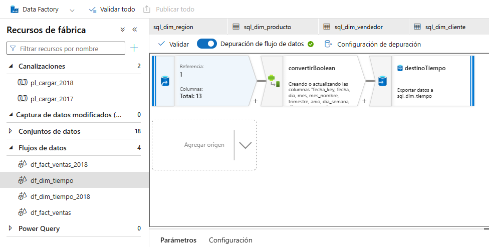
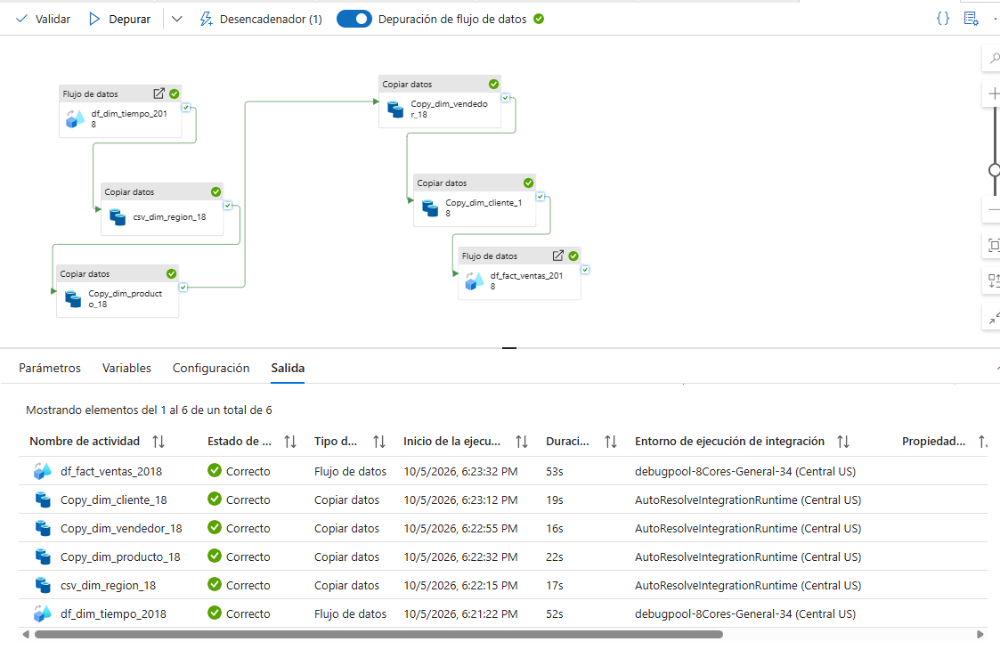
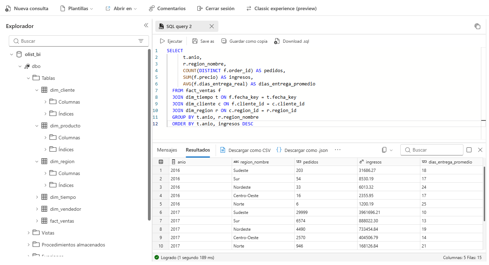
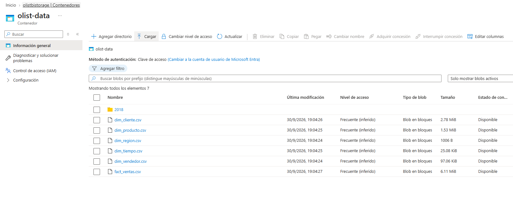

# Olist BI Dashboard - Power BI + Azure SQL + Azure Data Factory

Dashboard de Business Intelligence construido con datos reales del e-commerce brasileño Olist, conectado a Azure SQL Database y orquestado con Azure Data Factory.



## Arquitectura

```
Kaggle (CSV raw)
    │
    ▼
Python ETL ──────► CSV Star Schema (Gold)
    │                    │
    │                    ▼
    │              Azure Blob Storage
    │                    │
    │                    ▼
    ▼              Azure Data Factory
Azure SQL ◄──────── (Copy Data + Data Flow)
    │
    ▼
Power BI Desktop ──► Power BI Service
```

## Stack Tecnologico

| Componente | Tecnologia |
|------------|------------|
| Base de datos | Azure SQL Database |
| ETL | Python (pandas, pyodbc) |
| Orquestacion | Azure Data Factory |
| Almacenamiento | Azure Blob Storage |
| Visualizacion | Power BI Desktop |
| Datos fuente | Kaggle - Brazilian E-Commerce (Olist) |

## Modelo de Datos - Esquema Estrella



**Tabla de hechos:**
- `fact_ventas` - 112,650 registros (2016-2018)

**Tablas de dimension:**
- `dim_tiempo` - Fechas con atributos (mes, trimestre, dia de semana)
- `dim_producto` - Productos con categorias (portugues/ingles)
- `dim_cliente` - Clientes con segmentacion y ubicacion
- `dim_vendedor` - Vendedores con ubicacion
- `dim_region` - 27 estados de Brasil agrupados en 5 regiones

## Dashboard - 4 Paginas

### Pagina 1: Resumen Ejecutivo
KPIs principales (ingresos, pedidos, ticket promedio, entregas a tiempo), tendencia mensual, ventas por categoria y status de pedidos.


### Pagina 2: Analisis de Ventas
Top 10 categorias, ventas por metodo de pago, ventas por region, tabla detalle con % del total.



### Pagina 3: Analisis de Entregas
KPIs de entrega (dias promedio, flete), entregas a tiempo por region, flete por region, dias real vs estimado por categoria, status de entregas.



### Pagina 4: Detalle Operativo
Slicers de filtrado (fecha, region, categoria, status), tabla granular de todas las transacciones con cards de resumen dinamicas.



## Medidas DAX

```dax
Total Ingresos = SUM(fact_ventas[precio])
Total Pedidos = DISTINCTCOUNT(fact_ventas[order_id])
Ticket Promedio = DIVIDE([Total Ingresos], [Total Pedidos])
Total Items = COUNTROWS(fact_ventas)
Review Promedio = AVERAGE(fact_ventas[review_score])
Total Flete = SUM(fact_ventas[flete])
Flete Promedio = AVERAGE(fact_ventas[flete])
Productos Vendidos = DISTINCTCOUNT(fact_ventas[producto_id])
Dias Entrega Promedio = AVERAGE(fact_ventas[dias_entrega_real])
Dias Estimado Promedio = AVERAGE(fact_ventas[dias_entrega_estimado])

Entregas a Tiempo % = DIVIDE(
    CALCULATE(COUNTROWS(fact_ventas), fact_ventas[entrega_a_tiempo] = TRUE()),
    CALCULATE(COUNTROWS(fact_ventas), NOT ISBLANK(fact_ventas[entrega_a_tiempo])), 0)

% del Total = DIVIDE(
    [Total Ingresos],
    CALCULATE([Total Ingresos], ALL(fact_ventas)))
```

## Pipeline de Datos

### Estrategia de carga por anio

La carga se dividio por anio para demostrar diferentes herramientas:

| Anio | Metodo | Registros | Proposito |
|------|--------|-----------|-----------|
| 2016 | Python (pyodbc) | 370 | Carga inicial, aprender SQL directo |
| 2017 | ADF Pipeline (manual) | 50,864 | Aprender Copy Data + Data Flow |
| 2018 | ADF Pipeline (trigger) | 61,416 | Automatizacion con triggers |

### Scripts Python

| Script | Descripcion |
|--------|-------------|
| `01_explorar_datos.py` | Exploracion de los 9 CSVs crudos de Kaggle |
| `02_transformar_datos.py` | ETL completo: limpieza, traduccion, esquema estrella |
| `07_dividir_por_anio.py` | Divide datos transformados por anio (2016/2017/2018) |
| `08_cargar_2016.py` | Carga inicial de 2016 a Azure SQL |
| `10_cargar_2016_incremental.py` | Carga incremental de 2016 sin borrar otros anios |

### Azure Data Factory - Componentes

**Linked Services:**
- `ls_blob_olist` - Conexion a Azure Blob Storage (olistbistorage)
- `ls_sql_olist` - Conexion a Azure SQL Database (olist-bi-server)

**Pipelines:**
- `pl_cargar_2017` - 4 Copy Data + 2 Data Flows
- `pl_cargar_2018` - 4 Copy Data + 2 Data Flows + trigger programado

**Data Flows (transformacion dentro de ADF):**
- `df_dim_tiempo` / `df_dim_tiempo_2018` - Convierte es_fin_semana (0/1 → boolean)
- `df_fact_ventas` / `df_fact_ventas_2018` - Maneja tipos de datos para fact_ventas

**Pipeline en ADF:**



**Data Flow (transformacion de tipos):**



**Ejecucion exitosa:**



**Orden de ejecucion del pipeline:**
```
dim_tiempo → dim_region → dim_producto → dim_vendedor → dim_cliente → fact_ventas
```
Las dimensiones se cargan primero (con upsert) para respetar las Foreign Keys antes de insertar los hechos.

### Scripts previos (DELETE por rango de anio)

Para evitar borrar datos de otros anios, cada pipeline usa DELETE filtrado:

```sql
-- Solo borra datos del anio que va a recargar
DELETE FROM fact_ventas WHERE fecha_key >= 20170101 AND fecha_key <= 20171231;
DELETE FROM dim_tiempo WHERE fecha_key >= 20170101 AND fecha_key <= 20171231;
```

Las dimensiones compartidas (region, producto, vendedor, cliente) usan **upsert** en vez de DELETE+INSERT.

## Como agregar un nuevo anio (ej. 2019)

Para cargar datos de un nuevo anio, el proceso es:

### 1. Preparar los datos
```bash
# Colocar los CSVs crudos en data/raw/
# Ejecutar el ETL
python scripts/02_transformar_datos.py
# Dividir por anio
python scripts/07_dividir_por_anio.py
```

### 2. Subir a Azure Blob Storage
- Ir a portal.azure.com → Storage Account `olistbistorage`
- Contenedor `olist-data` → Cargar archivos
- En Avanzado → "Cargar en carpeta": `2019`
- Subir los 6 CSVs

### 3. Crear pipeline en ADF (o duplicar existente)
- Crear 6 datasets CSV apuntando a la carpeta `2019`
- Crear 2 Data Flows (dim_tiempo y fact_ventas) con:
  - Proyeccion: fecha_key como integer, es_fin_semana como integer
  - Script previo con rango 2019: `WHERE fecha_key >= 20190101 AND fecha_key <= 20191231`
- Crear pipeline con 4 Copy Data (upsert) + 2 Data Flows
- Conectar en orden: dim_tiempo → dim_region → dim_producto → dim_vendedor → dim_cliente → fact_ventas

### 4. Configurar trigger (opcional)
- Trigger de programacion: ejecutar a una hora especifica
- Trigger de evento de almacenamiento: ejecutar automaticamente cuando se suben archivos al Blob

### 5. Actualizar Power BI
- Clic en "Actualizar" en Power BI Desktop
- Los nuevos datos aparecen automaticamente (mismo esquema, mismas tablas)

## Infraestructura Azure





| Recurso | Nombre | Region |
|---------|--------|--------|
| Resource Group | rg-powerbi-project | - |
| SQL Server | olist-bi-server | Central US |
| SQL Database | olist_bi | Central US |
| Storage Account | olistbistorage | Central US |
| Data Factory | olist-bi-adf | Central US |

## Lecciones aprendidas

1. **Esquema estrella vs snowflake**: Se removieron relaciones dimension-a-dimension para evitar caminos ambiguos en Power BI
2. **DELETE sin WHERE es peligroso**: Siempre usar filtros por rango de fecha para cargas incrementales
3. **Ambientes DEV/QA/PROD**: En produccion real, nunca se trabaja directo sobre datos reales
4. **ADF Copy Data vs Data Flow**: Copy Data es rapido pero limitado en transformaciones; Data Flow permite conversiones de tipos pero usa Spark (mas lento)
5. **Upsert para dimensiones compartidas**: Evita errores de clave duplicada cuando multiples anios comparten registros
6. **NaN vs NULL**: Python pandas usa NaN, SQL Server usa NULL. Conversion explicita necesaria con pyodbc
7. **BIT vs Boolean**: ADF no convierte "0"/"1" a boolean automaticamente; se necesita Data Flow o cambio de tipos

## Requisitos

```bash
pip install -r scripts/requirements.txt
```

- Python 3.10+
- ODBC Driver 18 for SQL Server
- Power BI Desktop
- Cuenta de Azure (free tier funciona)
